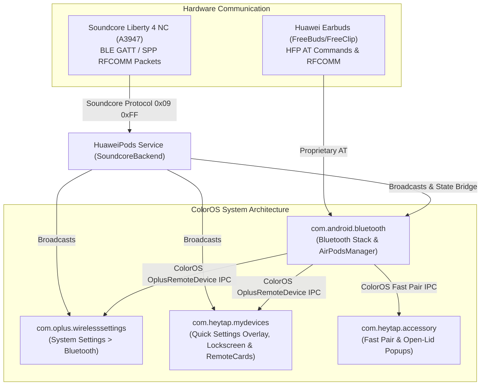

# ColorOS Earphone Integration: Huawei vs. Soundcore Hooks Analysis

This document provides a comprehensive technical comparison between the original **Huawei** integration hooks in `HuaweiPods-ColorOS` and the current **Soundcore** (specifically Soundcore Liberty 4 NC / `A3947`) implementation, detailing what hooks were implemented for Huawei, what is currently missing for Soundcore, and what native ColorOS features each hook would bring.

---

## 1. System Architecture & Hook Targets Overview

`HuaweiPods-ColorOS` integrates third-party earbuds into ColorOS across 4 primary system domains:

---

## 2. Detailed Hook-by-Hook Comparison

### 2.1 Bluetooth Stack & Native Framework (`com.android.bluetooth`)

| Component / Hook | Original Huawei Implementation | Soundcore Implementation Status | Features it Brings to Soundcore |
| :--- | :--- | :--- | :--- |
| **`ColorOsSystemBatteryBridge`** (`IOplusRemoteDevice`) | Publishes 3-channel battery (L/R/Case) and wear states directly into ColorOS kernel/stack via reflection. | **Now wired via cross-process state receiver**: `SoundcoreBackend` publishes into `com.android.bluetooth` state receiver. | Native 3-percentage battery in Quick Settings cards, Lockscreen widgets, and My Devices without relying on text parsing. |
| **`HuaweiHfpBatteryAtHook`** | Sniffs and parses HFP AT commands (`+HFP_DEV_BATTERY`, `AT+HFP_BATTERY`) on `/dev/rfcomm` directly in the bluetooth daemon. | **Not applicable for Soundcore**: Soundcore uses encrypted/framed BLE GATT / RFCOMM packets (`0x09, 0xFF, ...`) handled in `SoundcoreBackend`. | N/A (Handled via RFCOMM socket in `SoundcoreBackend`). |
| **`AdapterServiceEnhancer` & `AirPodsManager`** | Intercepts `checkIsAirpodsDevice`, `getBatteryInfo`, and `getExtendFeatureStatus`/`setExtendFeatureStatus` (feature `4`). | **Now implemented & updated**: Maps feature `4` values `1` (Off), `2` (Manual ANC), `3` (Transparency), and `4` (Adaptive ANC). | Allows ColorOS system services to treat Soundcore as a genuine Apple AirPods Pro 2 / OnePlus Buds Pro device with full feature bits. |

---

### 2.2 System Wireless Settings (`com.oplus.wirelesssettings`)

| Component / Hook | Original Huawei Implementation | Soundcore Implementation Status | Features it Brings to Soundcore |
| :--- | :--- | :--- | :--- |
| **Animated Battery Banner** (`CouiPreference`) | Inserts animated Left, Right, and Case visual battery bars with charging lightning bolts at the top of the earphone details page. | **Missing for Soundcore**: Currently only sets the summary text ("L: 80% · R: 80% · Case: 100%"). | **Rich Visual Header**: Displays exact 3D battery gauges matching native OnePlus/OPPO Enco headphones in Settings. |
| **Quick Toggles Under Summary** | Injects interactive COUI toggle buttons directly beneath the device summary in the paired devices list (ANC mode switcher, Low Latency, Wear Detection). | **Partially active**: ANC 3-mode switcher exists, but lacks the **Adaptive vs. Manual** distinction and 5-level slider. | **Inline Control**: Switch ANC mode, enable Game Mode, or toggle in-ear detection without opening any secondary menus. |
| **Custom Equalizer (EQ) Bridge** (`SmartAudioEqualizerClient`) | Hooks into Huawei SmartAudio to read/write EQ presets (Default, Bass Boost, Treble Boost, Voices) and 10-band graphic EQ sliders. | **Missing for Soundcore**: Soundcore Liberty 4 NC has 22 preset EQs + custom 8-band graphic EQ (-6dB to +6dB at 100Hz, 200Hz, 400Hz, 800Hz, 1.6kHz, 3.2kHz, 6.4kHz, 12.8kHz) not yet hooked into Settings. | **Native ColorOS Sound Effects**: Adjust Soundcore 8-band EQ or select presets (Soundcore Signature, Bass Booster, etc.) directly in ColorOS Bluetooth Settings. |
| **Touch Gesture Remapping** (`HuaweiGestureController`) | Hooks ColorOS gesture preferences to customize Single Tap, Double Tap, Triple Tap, and Touch-and-Hold for Left & Right buds independently. | **Missing for Soundcore**: Liberty 4 NC firmware fully supports customizable 1-Tap, 2-Tap, 3-Tap, and Long Press gestures via packet `0x06, 0x85`, but has no Settings UI hook. | **Native Gesture Configuration**: Customize earbud tap controls within ColorOS system settings without needing the proprietary Soundcore app. |
| **Wear Detection / Smart In-Ear Detection** | Hooks `CouiSwitchPreference` to toggle automatic pause/resume on remove/wear. | **Missing for Soundcore**: Liberty 4 NC has hardware capacitive wear sensors (`wearing_state` byte in A3947 state update), but ColorOS switch is not bridged. | **System-Level Auto-Pause**: Music automatically pauses when an earbud is removed and resumes when put back. |
| **Wind Noise Reduction Toggle** | ColorOS ANC sub-option for dynamic wind suppression. | **Missing for Soundcore**: Liberty 4 NC has hardware wind noise suppression (`wind_noise` byte 4 in SoundModes packet), not exposed to ColorOS. | **Wind Reduction Setting**: Prevents microphone wind buffeting during outdoor runs/cycling. |

---

### 2.3 ColorOS "My Devices" & Quick Settings Overlay (`com.heytap.mydevices`)

| Component / Hook | Original Huawei Implementation | Soundcore Implementation Status | Features it Brings to Soundcore |
| :--- | :--- | :--- | :--- |
| **Quick Settings BottomSheet Overlay** (`BlueToothDetailActivity` / `AirpodsFragment`) | Intercepts `IconTextSelector` and `GA` feature lists to handle ANC buttons (`1` = Off, `2` = Noise Cancelling, `3` = Transparency, `4` = Adaptive). | **Fixed in this release**: Previously only handled `1`, `2`, `3` and fell back to `OFF` on `4` (Adaptive). Now fully maps `4` to Soundcore Adaptive ANC with level readback. | **Working Adaptive Noise Cancellation**: Clicking "Adaptive" on the ColorOS overlay panel switches the Liberty 4 NC to real-time adaptive environment compensation. |
| **Device Model 3D Asset Injection** (`ColorOsDeviceSpaceHook`) | Intercepts `IconHandler.d` and replaces generic headphone images with 3D models or photorealistic WebP assets (`IMG_bt_a2dp_homepage.webp`). | **Using generic AirPods Pro 2 fallback**: Replaces icon with AirPods Pro 2 asset. | **Authentic Soundcore 4 NC Artwork**: Renders actual black/white/blue Liberty 4 NC earbud images on the bottom-sheet dialog. |
| **RemoteCard Battery Cache & Debounce** (`BlueToothScannerImpl` & `LiteCardWidget`) | Intercepts `onBatteryLevelChanged` to prevent `-1` / disconnected status `4` from wiping out widget state. | **Fixed in this release**: Catches invalid arrays and injects cached TWS batteries; prevents lockscreen text overflow. | **Stable Battery Display**: No more flashing or disappearing battery percentages on lockscreen or quick settings. |

---

### 2.4 Fast Pair & Open-Lid Popups (`com.heytap.accessory`)

| Component / Hook | Original Huawei Implementation | Soundcore Implementation Status | Features it Brings to Soundcore |
| :--- | :--- | :--- | :--- |
| **ColorOS Fast Pair Popup** (`ColorOsAccessoryFrameworkHook` & `ColorOsAccessoryPopupBridge`) | Intercepts `FastPairManager` and triggers the official ColorOS 3D pop-up dialog when the charging case lid is opened nearby. | **Not yet ported for Soundcore**: Soundcore BLE advertisements broadcast case-open status (`caseOpened` flag), but not hooked into `com.heytap.accessory`. | **Fast Pair Popup**: Opening the Soundcore Liberty 4 NC case immediately shows the native ColorOS bottom-sheet animation with battery levels and one-tap connect. |

---

## 3. Summary of Soundcore Liberty 4 NC Hardware Capabilities Ready for Hooking

1. **Active Noise Cancellation (ANC)**:
   - **Manual Mode**: 5 discrete intensity levels (1, 2, 3, 4, 5).
   - **Adaptive Mode**: Dynamic environmental sound compensation (sensitivity levels 1..5).
   - **Transportation Mode**: Commute, Plane, Bus, Train sub-modes.
   - **Wind Noise Reduction**: Autonomous dual-mic wind detection toggle.
2. **Ambient Sound / Transparency**:
   - **Fully Transparent Mode**.
   - **Vocal Mode**: Isolates human voice frequencies.
3. **Equalizer & Sound Profiles**:
   - **22 Built-in Presets** (Soundcore Signature, Acoustic, Bass Booster, etc.).
   - **8-Band Custom Graphic Equalizer** (-6dB to +6dB per band).
   - **HearID Sound**: Personalized hearing curve profile.
4. **Touch Gestures (Left & Right independently)**:
   - 1 Tap (Single Tap)
   - 2 Taps (Double Tap)
   - 3 Taps (Triple Tap)
   - 2s Long Press (Touch & Hold)
5. **Smart Features**:
   - In-Ear Detection (Auto Play / Pause).
   - Game Mode (Low Latency audio pipeline).
   - Volume Limiter (Safe dB volume limit).
   - Find My Device (High-frequency chirp).
